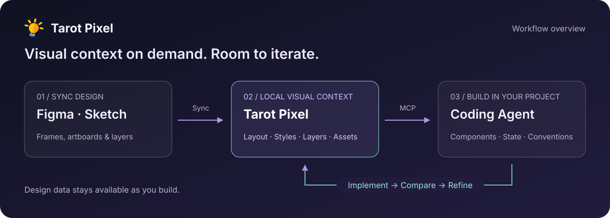

[简体中文](README.md) · **English**

# Tarot Pixel

### Help your coding agent understand designs

Turn designs into visual context your agent can query, preview, and revisit. 
Build and refine interfaces using the conventions of your project.

[Quick start](docs/en/quick-start.md) · [Visual context](docs/en/design-philosophy.md) · [Feedback](https://github.com/tarot-ai-labs/tarot-pixel/issues/new/choose)

**Figma · Sketch → Tarot Pixel → Qoder / MCP clients**

https://github.com/user-attachments/assets/4f93a7d4-a2d3-4270-94d2-85a09240be8e

## Bring designs into your project

Tarot Pixel lets your agent look up layouts, styles, and images as needed, reuse your existing components, and revisit design details while refining the implementation.

> Use Tarot Pixel to implement this design: `<synced design link>`. Reuse our existing components and keep titles, prices, and buttons dynamic. Preview the page and compare it with the design to refine the details.

## What you can do

| Your task | What Tarot Pixel provides |
| --- | --- |
| Find a page or component | Design overviews, module previews, and layer search |
| Reproduce layout and styling | Dimensions, spacing, typography, colors, and hierarchy |
| Handle complex decoration | Single-layer and multi-layer composites |
| Implement different states | Module comparisons to use alongside business requirements |
| Check the result | Design screenshots and a local preview for comparison and refinement |
| Use design assets | Images and font subsets |

## Get started

1. **Enable the plugin.** Install and enable Tarot Pixel from the [Qoder marketplace](https://qoder.com/zh/marketplace/plugin?id=tarot-pixel).
2. **Sync a design.** Select frames, artboards, or layers in Figma or Sketch, run Tarot Pixel, and choose **Sync design**.
3. **Give the agent a task.** Share the complete link returned by the sync and describe what to build in your project.

[Follow the quick start →](docs/en/quick-start.md)

| Integration | Get it |
| --- | --- |
| Figma | [Open the Figma plugin](https://www.figma.com/community/plugin/1635645029043726171) |
| Sketch | [Download the plugin ZIP](https://unpkg.com/@tarot-ai/tarot-pixel-sketch-release@latest/Tarot-Pixel.sketchplugin.zip); requires Sketch 80.0 or later |
| Qoder | [Open the Qoder marketplace](https://qoder.com/zh/marketplace/plugin?id=tarot-pixel) |
| Other MCP clients | [View configuration instructions](docs/en/installation.md#configure-mcp-directly) |

## Visual context

Start with the overview, look up details, implement within your project, and compare with the design. [Learn about visual context →](docs/en/design-philosophy.md)

## Documentation

[Quick start](docs/en/quick-start.md) · [Installation](docs/en/installation.md) · [Workflow](docs/en/workflow.md) · [FAQ](docs/en/faq.md)

## Feedback

[Report a bug](https://github.com/tarot-ai-labs/tarot-pixel/issues/new?template=bug-report.en.yml) · [Request a feature](https://github.com/tarot-ai-labs/tarot-pixel/issues/new?template=feature-request.en.yml) · [Join the discussion](https://github.com/tarot-ai-labs/tarot-pixel/discussions)
