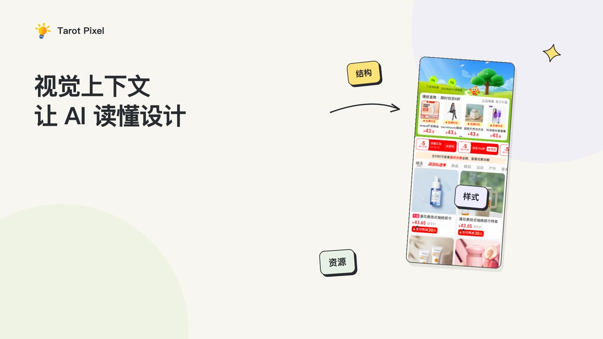

# 演示与案例

**简体中文** · [English](en/showcase.md)

[返回首页](../README.md) · [立即体验](quick-start.md)

## 50 秒了解视觉上下文

[观看 / 下载视频（MP4）](https://github.com/tarot-ai-labs/tarot-pixel/releases/download/visual-context-demo-20261011/tarot-pixel-visual-context-50s-zh-CN.mp4) · [下载可编辑工程（ZIP）](https://github.com/tarot-ai-labs/tarot-pixel/releases/download/visual-context-demo-20261011/tarot-pixel-animation-project.zip) · [发布页](https://github.com/tarot-ai-labs/tarot-pixel/releases/tag/visual-context-demo-20261011)

这段动画展示预览、结构、样式和资源如何成为 Agent 可查询的设计依据，并对比典型转换式 D2C 与上下文驱动的工作流程。Figma、Sketch 是设计入口，Qoder 是编码 Agent 示例。

视频为简体中文画面文字、轻音效，时长 50 秒，分辨率 1920 × 1080。其中 11 秒展示启用插件、同步设计、打开 View 和把设计链接交给 Qoder。

工程包含 Remotion 源码和所需素材，解压后执行 `npm install`、`npm run render` 可重新生成视频。

以下完整实现与视觉修正录屏仍在准备中。

## 待补充：从设计到组件

演示内容：连接 Tarot Pixel，在设计工具中同步一个组件，查看本地 View，把链接交给 Agent，在已有项目中实现并预览。

对应步骤见[快速开始](quick-start.md)。

<!-- 录屏完成后，在此粘贴上传到 GitHub 的视频附件链接或公开演示链接。 -->

## 待补充：通过对话修正视觉偏差

演示内容：展示首次实现，指出一个间距或背景问题，让 Agent 回查设计数据、修改代码，再展示同一视口下的结果。

对应提示词见[使用流程](workflow.md)。

<!-- 二次修正录屏完成后，在此补充视频链接。 -->

## 案例会记录哪些信息

每个正式案例会附带设计与实现对照，以及客户端、模型、Runtime 和设计插件版本、视口与字体条件。首次实现与修正后的结果分开展示，并记录人工介入次数和已知偏差。

当前页面尚未发布实际案例或统一测评结论。已有使用体验欢迎在[讨论区](https://github.com/tarot-ai-labs/tarot-pixel/discussions)分享。
